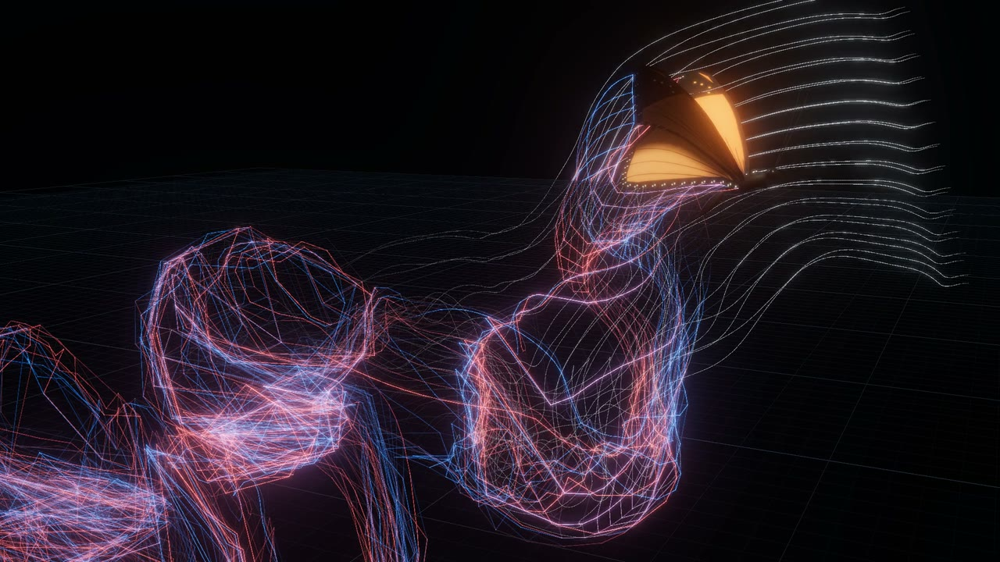

# butterfly-sim

A butterfly flight simulator in plain JavaScript. It models the air with a 3-D unsteady vortex lattice, couples it to the dynamics of the body, and drives both with the measured wingbeat of a monarch. It runs in Node and live in the browser. It has no dependencies; the viewer loads three.js.

[](media/monarch_wake_540p.mp4)

*A monarch's measured wingbeat at 20× slow motion: smoke-wire streaklines, then the red and blue vortices each stroke leaves behind ([30 s video](media/monarch_wake_540p.mp4)).*

## What it can do

- **Unsteady aerodynamics.**
  - **Lattice:** each side's fore- and hindwing, which fly overlapped, are one vortex-lattice wing.
  - **Wake:** a free wake rolls up behind every stroke.
  - **Wing–wing interaction:** the two wings induce flow on each other, so the clap and fling come out of the solution.
  - **Included effects:** added mass, wake capture and the effect of body motion on the air. Leading-edge-vortex lift is added with the Polhamus suction analogy.
  - **Comparison model:** a quasi-steady blade-element model runs on the same geometry.
- **Measured wingbeats.**
  - **Monarch:** the preset plays the measured flap, feathering, deviation, body pitch and abdomen motion of a monarch in climbing flight (Fourier fits to motion capture).
  - **Deformation:** wings can also twist, camber and bend.
  - **More species:** five others come with measured morphology and partly assumed wingbeats.
- **Flight, not only forces.**
  - **Body:** a thorax, a hinged abdomen and the wing masses.
  - **Modes:**
    - *wind tunnel:* motion prescribed;
    - *free flight:* the body moves under its own forces while its pitch follows the measured history;
    - *fully free:* six degrees of freedom with a flight controller (experimental).
  - **Outputs:** it trims itself to steady flight, takes gusts, and reports lift, thrust, pitching moment and power.
- **Seeing the air.**
  - **Live viewer:** wake filaments, smoke tracers, wing loads, force charts, and sliders for every wingbeat parameter.
  - **Film:** a renderer turns runs into film.

## How accurate it is

- **Against theory, within a few percent.** Each of these runs in `node --test tests/`:
  - steady lift slope within 1.5 % of lifting-surface theory;
  - an impulsively started wing within 3 % of Wagner's function;
  - a plunging wing within 5 % in amplitude and 1° in phase of Theodorsen's theory;
  - momentum conserved to 1 part in 10⁴.
- **Against butterflies, close where the inputs are measured.**
  - **Lift balance:** take the measured monarch wingbeat at its measured speed and climb, untrimmed. Once the wings carry a modest camber, the solver gives 0.96 of the body weight in lift, a net thrust of −0.05 weight and a pitching moment near zero. The camber is assumed (12 % in the downstroke, 6 % in the upstroke), within the range measured on painted-lady wings.
  - **Flat wings fall short:** flat rigid wings carry only half the weight, as published rigid-wing models also find.
  - **Trim and free flight:** balancing the forces exactly moves the measured wingbeat by under 5°. In free flight the monarch settles at 1.6 m/s in a 26° climb; the real one flew at 1.42 m/s and 23°.
- **Where it is weaker.**
  - **Painted lady:** its wingbeat is reconstructed by eye from published figures. Peak and RMS lift fall inside the range measured on the animal, but mean lift comes out 55 % high.
  - **The clap:** it adds thrust as the wings close, but the upstroke as a whole gives net drag, where real butterflies get thrust. The real clap is flexible, and that is the likely difference.
  - **Fully free flight:** pitch is unstable within one wingbeat, as in published butterfly models. The controller holds it for a few beats only.
- **What it does not resolve.**
  - flow separation and the leading-edge vortex itself;
  - wing elasticity, since deformation is prescribed;
  - viscous decay of the wake beyond a core-growth law.

  Use it for trends, force magnitudes, power and wake topology, not for the near-wing flow detail that needs CFD.

More detail:
- **Validation:** every comparison with published data is in [reports/validation.md](reports/validation.md).
- **Ingredients:** what each piece of the physics is worth is in [reports/monarch/study.md](reports/monarch/study.md).
- **Model:** the full description is in [docs/model.md](docs/model.md).

## Run it

```sh
git clone https://github.com/mishaevoma/butterfly-sim && cd butterfly-sim
python3 -m http.server 8642            # the viewer, at http://localhost:8642/
node --test tests/                     # benchmarks, about 25 s (Node 18+)
node tools/validate_butterflies.mjs    # regenerates reports/validation.md, about 3 min
```

```js
import { FlightSim } from './src/sim.js';
const sim = new FlightSim({ species: 'monarch', aero: 'uvlm', mode: 'tethered' });
sim.run(4);                    // four wingbeats
console.log(sim.averages(1));  // lift/weight, thrust/weight, moment, power …
```

To make the film, run `node tools/film_record.mjs`, then `node tools/render_film.mjs`. This needs Google Chrome, puppeteer-core and ffmpeg.

## Layout

| Path | What |
|---|---|
| `src/` | the solver: vortex lattice, quasi-steady model, wing geometry, kinematics, body dynamics, trim, control and species presets |
| `index.html`, `viewer/` | the wind-tunnel viewer (three.js, a web worker, force charts) |
| `tests/` | analytic and multibody benchmarks |
| `tools/` | validation, the study, trims, controller tuning, film recording and rendering |
| `reports/` | validation and study reports with figures |
| `research/` | sourced notes on morphology, kinematics, validation targets and existing codes |
| `docs/` | the model in detail |
| `film/`, `media/` | the film page, and the poster and compact video |

## Data and credits

- **Monarch data:** kinematics, segment masses and the combined wing outline come from the [FWUAV](https://github.com/fdcl-gwu/FWUAV) repository (fdcl-gwu, George Washington University), fitted to motion capture of a monarch in climbing flight. That monarch's wing size is from Pohly et al. (2022).
- **Sources:** `research/kinematics_morphology.md` lists the source of every number and how it was obtained.
- **Validation targets:**
  - Bode-Oke & Dong (2020);
  - Zheng, Hedrick & Mittal (2013);
  - Johansson & Henningsson (2021);
  - Yokoyama, Senda, Iima & Hirai (2013).

  See `research/validation_and_code.md`.
- **three.js:** r160 (MIT licence), loaded from jsDelivr.
