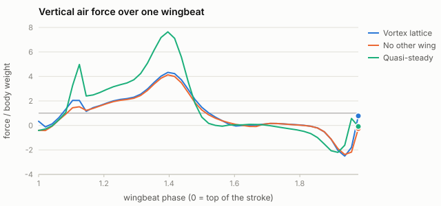
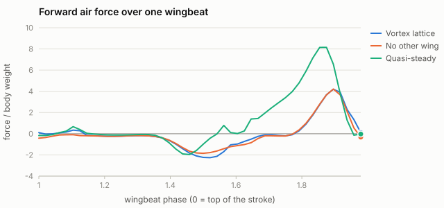
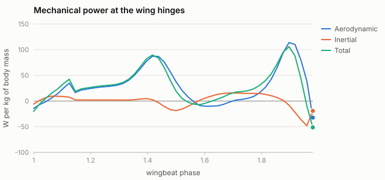
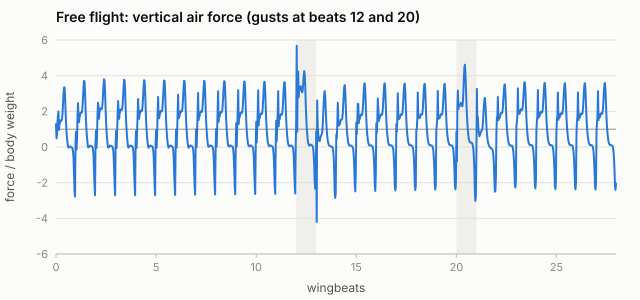
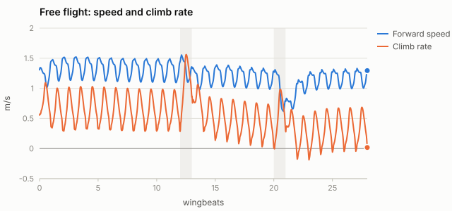
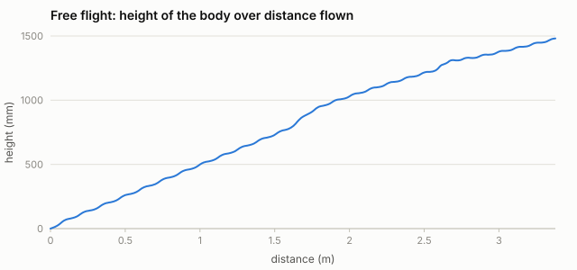

# Monarch (*Danaus plexippus*): what each piece of the physics is worth

Generated by `node tools/study.mjs monarch` on 2026-10-25 in 144 s.
Vortex lattice at 6 × 12 panels per wing, 48 steps per wingbeat, a 3-beat free wake.

## The animal and its wingbeat

| | |
|---|---|
| Body mass | 0.500 g (wings 0.050 g) |
| Forewing length R | 52.0 mm |
| Wing area, both pairs (union of fore- and hindwing) | 30.2 cm² |
| Mean chord, aspect ratio | 29.1 mm, 3.58 |
| Wingbeat frequency | 10.2 Hz |
| Trimmed stroke amplitude, stroke-plane tilt, mean sweep | 128.7°, -25.8°, -0.6° |
| Body pitch (prescribed when tethered) | 18.61° ± 8.3° |
| Flight path | 1.42 m/s at a 23° climb |
| Reynolds number (mid-span, mean chord), reduced frequency, advance ratio | 3594, 0.66, 0.60 |

## Cycle means with one piece removed

Each row reruns the trimmed wingbeat with one change. Forces are cycle means over the fifth beat, in body weights. The moment is about the centre of mass, divided by weight × mean chord; positive is nose-up. Power is the cycle mean of the positive mechanical power at the hinges (no elastic storage), per kg of body mass.

| Case | Lift / weight | Thrust / weight | Pitch moment | Power (W/kg) |
|---|---|---|---|---|
| Vortex lattice, trimmed | 1.01 | -0.00 | -0.001 | 32.4 |
| Without the other wing (no clap or fling) | 0.87 | -0.06 | -0.000 | 30.9 |
| Without leading-edge vortex lift | 0.85 | 0.03 | 0.022 | 31.7 |
| Body held at constant pitch | 1.19 | -0.06 | 0.029 | 35.2 |
| Quasi-steady lens, same kinematics | 1.51 | 1.14 | 0.233 | 60.2 |

## Free flight

Here the body moves under its own forces, while its pitch follows the measured history as in Fei & Yang's simulations; the fully free case is in `reports/validation.md`. It starts from the trim above. The controller holds the climb rate with stroke amplitude and the speed with stroke-plane tilt. It meets a one-beat updraft at beat 12 and a one-beat headwind at beat 20, both 0.8 m/s. In the last beat it flies at 1.19 m/s forward and 0.34 m/s up, bobbing 9.0 mm per stroke about its mean path.

