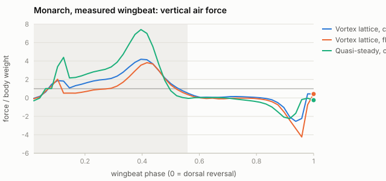
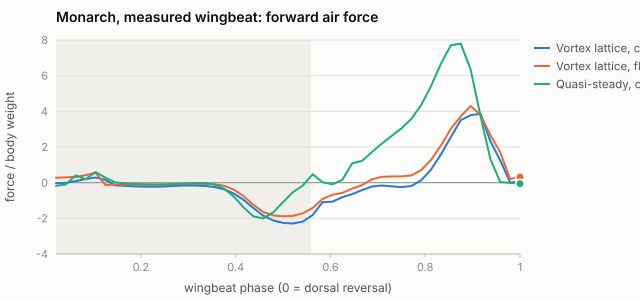
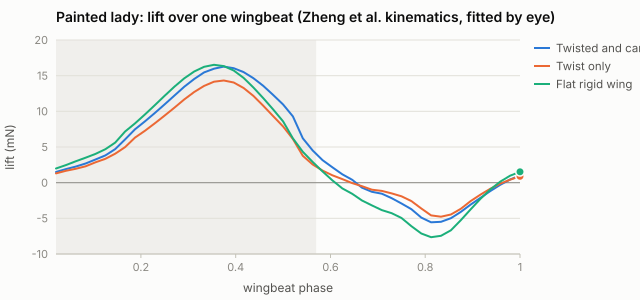
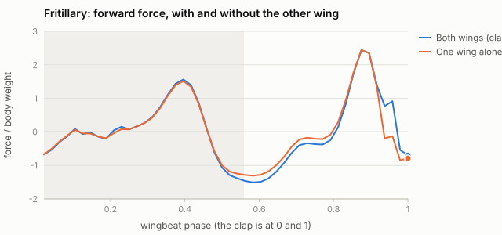

# Validation against published butterfly data

Generated by `node tools/validate_butterflies.mjs` on 2026-10-25 (150 s). Vortex lattice at 6 × 12 panels per wing, 48 steps per wingbeat, 3-beat free wake. Targets and their sources are in `research/validation_and_code.md`; inputs are in `research/kinematics_morphology.md`. Forces are cycle means in body weights (W); moments are about the centre of mass, divided by W × mean chord, with positive nose-up.

## 1. Monarch: the measured wingbeat, untrimmed, at the measured climb

The kinematics are the FWUAV Fourier fits to one monarch in VICON climbing flight: flap, feathering, deviation, thorax pitch and abdomen. The run uses that flight's 1.42 m/s at a 23° climb. A steady climb needs lift = 1 W, thrust = 0 and moment = 0.

| Model | Lift / W | Thrust / W | Moment |
|---|---|---|---|
| Vortex lattice, flat wing | 0.51 | 0.22 | 0.123 |
| Vortex lattice, camber 12 % (downstroke) / 6 % (upstroke) | 0.96 | -0.05 | -0.016 |
| Quasi-steady, flat wing | 1.42 | 1.04 | 0.210 |
| Quasi-steady, cambered | 1.42 | 1.04 | 0.211 |

- **A flat rigid wing supports about half the weight.** Rigid flat-plate CFD of the painted lady gives 0.50–0.73 W (Zheng et al. 2013), and the Kyoto panel model predicted 0.3 mN against 2.4 mN measured for *Parantica*. The flat-wing deficit is a known property of rigid models.
- **Camber closes the gap.** With the assumed camber, inside the 7–15 % measured on painted-lady wings, the measured wingbeat comes within a few percent of balancing on all three.
- **The quasi-steady lens has no wake downwash, and its flat-plate coefficients cannot see camber.** It overshoots: the same kinematics give 1.42 W of lift, cambered or not.
- **The trim barely moves the measured wingbeat.** Holding the camber, the vortex-lattice trim (lift = W, thrust = drag, moment = 0) changes it by:
  - stroke amplitude 129.54° against 124.71° measured;
  - stroke-plane tilt -26.02° against −25.4°;
  - mean sweep -1.28° against -1.98°.
- **Free flight lands close to the measured climb.** Released with the measured pitch history (pitch-driven free flight), the trimmed monarch settles at 1.59 m/s and a 26.3° climb, against 1.42 m/s at 23° measured. It bobs 9.7 mm per stroke.

## 2. Monarch: Bode-Oke & Dong 2020, case F1 (trend check)

F1 is level flight at 1.75 m/s, 9.92 Hz and a 103° stroke, with a stroke plane about 93° to the body axis and body angle 28° ± 4°. Feathering is about −11° in the downstroke and +10° in the upstroke, from their tabulated chord angles. Only summary angles are published, so the wingbeat here is the FWUAV waveform rescaled to them. Half-stroke means are in body weights:

| | Downstroke \|F\| | Downstroke vertical | Upstroke \|F\| | Upstroke vertical |
|---|---|---|---|---|
| Bode-Oke & Dong (CFD of the filmed flight) | 2.42 | 2.27 | 1.05 | −0.31 |
| Vortex lattice, flat | 3.41 | 3.29 | 0.39 | -0.31 |
| Vortex lattice, cambered | 4.30 | 4.14 | 0.10 | 0.10 |

- **Shared:** in both, the downstroke carries the weight.
- **Upstroke:** the flat wing matches their upstroke vertical force (-0.31 W against −0.31 W) but makes less total upstroke force.
- **Downstroke:** the reconstructed one is 1.4–1.8 times theirs. The reconstructed feathering is the most likely cause, since only half-stroke means are published.
- **Weight:** the measured-kinematics case in §1 is the cleaner test.

## 3. Painted lady: Zheng, Hedrick & Mittal 2013

The conditions are 22.2 Hz, a 120° stroke, 1.14 m/s and 6.1° body pitch. Twist and camber are fitted by eye to their figures, since no Fourier coefficients are published.

| | Mean lift (mN) | Peak lift (mN) | RMS lift (mN) | Aero power (mW) |
|---|---|---|---|---|
| Animal (lift from kinematics) | — | 11.5–18.0 | 6.2–10.2 | — |
| Zheng CFD, deforming wing (OBW) | 2.93 | 11.7 | 6.7 | 10.5 |
| Zheng CFD, flat plates (FPW1–3) | 1.42–2.07 | — | — | 9.81–13.7 |
| Vortex lattice, twisted and cambered | 4.55 | 16.27 | 8.23 | 13.17 |
| Vortex lattice, twist only | 3.75 | 14.32 | 6.90 | 10.67 |
| Vortex lattice, flat rigid wing | 3.96 | 16.53 | 8.45 | 14.86 |

- **Peak and RMS lift fall inside the animal's range.**
- **Mean lift is high.** The by-eye incidence is the likely cause.
- **Twist raises lift per watt.** Lift/power goes from 0.267 N/W (flat) to 0.352 N/W (twisted), the direction of their result (0.15 to 0.28 N/W).

## 4. The clap: Johansson & Henningsson 2021 (*Argynnis paphia*)

The fritillary preset is set to clap at the top of each upstroke. Its morphology is measured; the wingbeat is assumed.

| | Downstroke vertical impulse ÷ upstroke thrust impulse | Upstroke mean thrust (W) | Thrust while the wings close, last 15 % of the beat (W) |
|---|---|---|---|
| Johansson & Henningsson (PIV, take-off) | 9.4 | net thrust in 24 of 24 sequences | — |
| Vortex lattice, trimmed, both wings | no net upstroke thrust | -0.04 | 1.05 |
| Vortex lattice, trimmed, one wing alone | no net upstroke thrust | -0.04 | 0.74 |
| Measured monarch stroke plane (−25°), both wings | no net upstroke thrust | -2.13 | 0.70 |
| Measured monarch stroke plane (−25°), one wing alone | no net upstroke thrust | -1.70 | 0.54 |

- **The closing phase gives thrust.** As the wings close at the end of the upstroke, both wings give 30 % more thrust than one wing alone at the measured stroke plane, and 41 % more in the trimmed case.
- **The mean is not reproduced.** The model's upstroke as a whole gives net drag; in the animal the upstroke plus clap gave net thrust in every sequence.
- **The clap is rigid here.** The animal's clap is cupped and flexible (+22 % impulse over rigid wings in their clapper), and their numbers come from take-offs; this model has rigid wings in steady forward flight, with an assumed wingbeat.

## 5. Free-flight pitch stability

Each case is released from the trimmed tethered motion into fully free flight with no controller.

| | Wingbeats until pitch passes ±80° | Growth of a 0.2° pitch perturbation, per beat |
|---|---|---|
| Kyoto group, *Parantica sita* (measured joint angles; panel model with free wake) | about 1 | 8.6 (Floquet multiplier of the periodic orbit) |
| Monarch | 0.95 | 1.9 |
| Chestnut tiger | 0.58 | 5.6 |

The growth figure comes from the separation of two releases 0.2° apart, measured over the first 0.72 (monarch) and 0.43 (chestnut tiger) beats and expressed per beat. The tethered start is not on the periodic orbit, so the figure is not a Floquet multiplier; read it as an order of magnitude.

The free body tumbles within a wingbeat, as the Kyoto group's butterfly did. The pitch-driven free mode, and the controller in the fully free mode, exist because of that.
